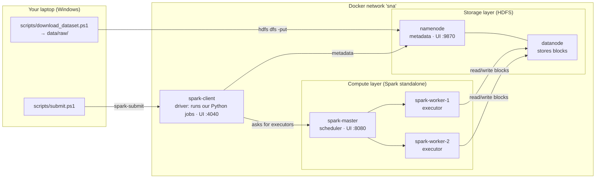

# Project Plan — Social Network Analysis on HDFS + Spark + GraphFrames

> Living document. Update it at the end of every phase.

## 1. Goal

Build a distributed graph-analytics system that loads social-network data into **HDFS**,
processes it with **Apache Spark**, and runs graph algorithms with **GraphFrames** to answer:

| Question | Feature |
|---|---|
| Who are the most important people? | Influencer Detection |
| Which groups exist? | Community Detection |
| What does the network look like overall? | Network Statistics |
| Who should a user befriend next? | Friend Recommendation |

We build it in phases: first everything on one laptop, then on a real cluster of friends' laptops, then with bigger datasets and more features.

---

## 2. Review of the original plan (what changed and why)

The original flow was: plan → setup → dataset → basic flow → bottom-up features. We kept it and made these changes:

1. **Added a Step 0: create the Git repo first.** Every later step becomes a commit, so GitHub shows progress from day one.
2. **Docker instead of installing Hadoop/Spark directly on Windows.** Native Hadoop on Windows needs `winutils.exe` hacks and breaks often. In Docker each "node" (NameNode, DataNode, Spark master, workers) is its own container, so **one laptop already runs a small distributed cluster**. The same images will later run on the friends' laptops.
3. **Every step has a "definition of done"** (a smoke test, a printed result, a screenshot of a UI). That keeps us from building on a broken base.
4. **Testing on a tiny graph with known answers.** We check each algorithm on a 4–10 node graph we can verify by hand before running it on real data.
5. **A fixed feature order in step 5:** stats → influencers → communities → recommendations. Each one reuses pieces of the one before (degrees → PageRank → components/LPA → mutual-friend motifs).
6. **Phase 2 networking is the biggest risk.** We prototype it early with *one* friend's laptop before involving everyone.
7. **Pinned versions + config, no hard-coded paths.** This keeps the code extensible: a new dataset or a new cluster should only need a config change.

---

## 3. Functional requirements

| ID | Requirement | Phase |
|---|---|---|
| FR-1 | **Ingest**: download a dataset, store it in HDFS under a standard layout | 1 |
| FR-2 | **Graph building**: load an edge list from HDFS into a GraphFrame (vertices + edges). Make undirected datasets symmetric (store both directions of each edge) | 1 |
| FR-3 | **Network stats**: #nodes, #edges, density, avg/max degree, degree distribution, connected components (count + largest), triangle count, average clustering coefficient | 1 |
| FR-4 | **Influencer detection**: top-K users by degree and by PageRank | 1 |
| FR-5 | **Community detection**: Label Propagation (LPA); community count and size distribution | 1 |
| FR-6 | **Friend recommendation**: for a given user, top-K non-friends ranked by number of mutual friends | 1 |
| FR-7 | **Output**: each job writes results to HDFS as Parquet and prints a short summary | 1 |
| FR-8 | **CLI**: each feature runs on its own job with arguments (`--dataset`, `--top-k`, `--user`) | 1 |
| FR-9 | Run the same jobs on a multi-laptop cluster without code changes | 2 |
| FR-10 | Advanced: k-core, Jaccard recommendation score, recommendations for all users in batch, Louvain communities, shortest paths / degrees of separation (done early: modularity in 1.7, Adamic-Adar tie-breaker in 1.8) | 3 |
| FR-11 | Evaluation: hide some edges and measure recommendation precision@K; compare communities with ground truth (com-Youtube) | 3 |
| FR-12 | Visualization: export subgraphs for Gephi, or a simple notebook/dashboard | 3 |

## 4. Non-functional requirements

| Category | Requirement |
|---|---|
| **Scalability** | Runs on 1 machine (Phase 1) and N machines (Phase 2) with only config changes |
| **Extensibility** | New dataset = new loader entry. New feature = new module + new job. No hard-coded paths or hosts |
| **Reproducibility** | Pinned versions, Docker, scripts. A teammate can clone and run the smoke test in under 30 minutes |
| **Correctness** | Every algorithm is checked on a tiny hand-verifiable graph |
| **Performance** | Phase 1: each job on ego-Facebook finishes in under 2 min. Phase 3: LiveJournal (69M edges) completes on the cluster |
| **Fault tolerance** | HDFS replication (1 in Phase 1, 2 in Phase 2). Checkpointing for iterative algorithms |
| **Resource limits** | Phase 1 cluster fits in about 8 GB of RAM given to Docker |
| **Observability** | HDFS UI (9870), Spark master UI (8080), job UI (4040), logs |
| **Documentation** | README shows current status + quickstart. `docs/` explains setup and design |

---

## 5. Technology stack

| Tool | Version | Role | Why |
|---|---|---|---|
| Docker Desktop (WSL2 backend) | latest | Runs every node as a container | Avoids Windows/Hadoop issues; same setup on every machine |
| Hadoop HDFS | 3.3.6 (`apache/hadoop`) | Distributed storage | Required by the project; Spark reads from it natively |
| Apache Spark | 3.5.3 (our `sna-spark` image = `apache/spark` + numpy; Java 17, Python 3.10) | Distributed compute | Stable line that GraphFrames supports |
| GraphFrames | `0.8.4-spark3.5-s_2.12` | Graph algorithms on DataFrames | PageRank, LPA, components, triangles, motifs, BFS |
| PySpark (Python) | bundled with Spark | Our code | Easiest to learn and read |
| Git + GitHub | latest | Version control, progress tracking | Shows continuous progress |

Later (Phase 3, only if needed): `pytest`, Jupyter, matplotlib, Gephi.

---

## 6. Architecture (Phase 1: single machine)



### Data flow (one job)

```
SNAP .txt.gz ──download──► data/raw/<ds>/          (laptop disk)
             ──hdfs put──► /sna/raw/<ds>/           (HDFS)
             ──Spark job──► Load → Build Graph → Analyze → Write
                                                        └─► /sna/output/<ds>/<feature>/  (Parquet)
```

### HDFS layout

```
/sna/raw/<dataset>/          original files as downloaded
/sna/processed/<dataset>/    cleaned vertices/ + edges/ (Parquet), built once and reused
/sna/output/<dataset>/<feature>/   results of each analysis
/sna/checkpoints/            needed by connectedComponents and other iterative algorithms
/sna/tmp/                    scratch (smoke tests)
```

---

## 7. Code design (grows over the phases)

```
SocialNetworkAnalysis/
├── docker-compose.yml        # the Phase 1 cluster
├── docker/                   # cluster config (hadoop.env, spark-defaults.conf)
├── scripts/                  # host-side helpers (download, load to HDFS, submit)
├── config/sna.ini            # app settings: HDFS layout + dataset registry
├── jobs/                     # thin entry points: parse args → call src/sna → write
├── src/sna/                  # reusable library (step 1.4 ✅)
│   ├── config.py             #   reads config/sna.ini
│   ├── session.py            #   SparkSession + checkpoint dir
│   ├── loaders.py            #   raw edge list → cleaned Parquet → GraphFrame
│   ├── storage.py            #   writes results to HDFS
│   ├── cli.py                #   --dataset / --config shared by all jobs
│   └── features/             #   analysis functions: GraphFrame in, DataFrames out
│       ├── stats.py          #     step 1.5 ✅ degrees, components, triangles, clustering
│       ├── influencers.py    #     step 1.6 ✅ degree centrality, PageRank, ranking comparison
│       ├── communities.py    #     step 1.7 ✅ Label Propagation, community profiles, modularity
│       └── recommend.py      #     step 1.8 ✅ mutual friends + Adamic-Adar, community check
│       ├── stats.py
│       ├── influencers.py
│       ├── communities.py
│       └── recommend.py
├── tests/                    # step 1.9 ✅ tiny graphs with known answers (unittest, local mode)
├── docs/
└── data/                     # local downloads (git-ignored)
```

**Design rules (these keep it extensible):**
- **Pipeline**: every job follows `load → build graph → analyze → write`.
- **Loaders**: `load(spark, dataset) -> GraphFrame`. A registry maps dataset names to file paths and formats. Adding a dataset means adding one registry entry.
- **Features**: plain functions `analyze(graph, **params) -> DataFrame`. They know nothing about paths or clusters, so they are easy to test on tiny graphs.
- **Jobs** handle the I/O. **Config** holds paths and hosts. **Features** stay pure.

### Where settings live (and what changes for a multi-PC cluster)

| Setting | File | Changes in Phase 2? |
|---|---|---|
| Spark master URL, HDFS NameNode (`fs.defaultFS`), memory, fixed ports | `docker/spark-defaults.conf` | no: names (`spark-master`, `namenode`) work on every PC |
| HDFS replication, DataNode name | `docker/hadoop.env` | step 2.4: replication 2 |
| Which containers run on which machine | `docker-compose.yml` (master, Phase 1), `docker-compose.cluster.yml` (master add-on), `docker-compose.worker.yml` (friend) | written in 2.1 |
| Which PC has which IP | `.env` per machine (git-ignored; templates `.env.*.example`) | every time IPs change |
| HDFS folder layout, dataset formats | `config/sna.ini` | no (paths have no host part) |
| Analytics code | `src/sna`, `jobs/` | **no** |

`scripts/container/spark_submit.sh` zips `src/sna` and sends it with `--py-files`, so
executors on other PCs can import our package without a shared folder.

### Feature → algorithm map

| Feature | Algorithm | GraphFrames API |
|---|---|---|
| Stats | degrees, components, triangles | `g.degrees`, `g.connectedComponents()`, `g.triangleCount()` |
| Influencers | degree centrality, PageRank | `g.degrees`, `g.pageRank(resetProbability=0.15, maxIter=10)` |
| Communities | Label Propagation | `g.labelPropagation(maxIter=5)` |
| Recommendation | mutual friends (open triangles) | DataFrame joins starting from the chosen users (same pattern as the motif `(a)-[]->(b); (b)-[]->(c); !(a)-[]->(c)`, but without building paths for every vertex) |
| Later | degrees of separation | `g.shortestPaths(landmarks=[...])`, `g.bfs(...)` |

---

## 8. Datasets (SNAP, Stanford)

| Phase | Dataset | Nodes | Edges | Type | Why |
|---|---|---|---|---|---|
| 1 (MVP) | **ego-Facebook** (`facebook_combined.txt`) | 4,039 | 88,234 | undirected friendships | Small, clean, real friendships; fits recommendation + communities |
| 3 | soc-Epinions1 | 75,879 | 508,837 | directed trust | Influencers in a directed network |
| 3 | com-Youtube | 1,134,890 | 2,987,624 | undirected + ground-truth communities | Lets us *evaluate* community detection |
| 3 | soc-LiveJournal1 | 4,847,571 | 68,993,773 | directed | Real scale test for the cluster |

Format: plain text, one `src dst` edge per line, separated by whitespace. Larger files start with `#` comment lines.

---

## 9. Phases and milestones

Each milestone is a Git tag, so progress is easy to show.

### Phase 0: Plan and repo → `v0.0`
- [x] Requirements, architecture, stack (this document)
- [ ] Git repo created and pushed to GitHub

### Phase 1: MVP on one machine → `v0.1` ✅ (all steps done, results in the README)
| Step | Work | Definition of done |
|---|---|---|
| 1.1 Setup | WSL2, Docker, Git, cluster `docker compose up` | HDFS UI shows 1 live DataNode. Spark UI shows 2 workers |
| 1.2 Smoke test | `jobs/00_smoke_test.py` | PageRank on a 4-node graph is correct; HDFS write/read works |
| 1.3 Dataset | download + load to HDFS | `/sna/raw/facebook/facebook_combined.txt` in HDFS, 88,234 lines |
| 1.4 Basic flow | `src/sna` skeleton: config, session, loader, writer | Job loads the graph and prints node/edge counts |
| 1.5 Network stats | FR-3 | Stats written to HDFS and printed |
| 1.6 Influencers | FR-4 | Top-10 by degree and PageRank |
| 1.7 Communities | FR-5 | Community count + sizes |
| 1.8 Recommendations | FR-6 | Top-5 suggestions for a given user |
| 1.9 Tests + results | tiny-graph tests, results summary in README | All tests pass |

### Phase 2: Real cluster (friends' laptops) → `v0.2`

Your laptop runs HDFS + spark-master + the driver + 1 worker. Each friend's PC runs 1 Spark worker,
and later also a DataNode. Guide: [PHASE2_SETUP.md](PHASE2_SETUP.md).

**Networking decision (the known risk).** Docker Desktop on Windows sits behind NAT: a container
IP (172.x) means nothing to other PCs. We keep Docker Desktop (same setup on every PC, no Linux
needed) and solve it with two rules:
1. **Names, not IPs.** Every process advertises a name (`--host`, `spark.driver.host`,
   `dfs.datanode.hostname`). Inside its container the name means "me". On other PCs,
   `extra_hosts` (from a per-machine `.env`) maps it to that PC's Wi-Fi IP.
2. **Fixed ports, the same on both sides** (7077 master, 7078 worker, 7079 executors,
   7080/7081 driver, 8020/9866 HDFS), published by Docker and opened by `open_firewall.ps1`.

Rejected for now: WSL2 mirrored networking + host networking (Windows 11 only, Docker Engine inside
WSL instead of Docker Desktop, so a different setup per PC), and Docker Swarm overlay networks
(the same NAT problems, plus more moving parts).

| Step | Work | Definition of done |
|---|---|---|
| 2.1 Cluster config ✅ | names + fixed ports, `docker-compose.cluster.yml` (master), `docker-compose.worker.yml` (friend), `.env` templates, `cluster_up` / `worker_up` / `open_firewall` scripts, guide | Phase 1 unchanged (smoke test, 35 tests). **Simulated friend on one laptop** (worker reached only through the Wi-Fi IP): smoke test + full pipeline pass |
| 2.2 First friend | one friend's PC joins | Smoke test lists `worker-<friend>` |
| 2.3 Second friend | 3 PCs, 6 cores | `run_all.ps1` timings vs the 121 s baseline. Fault-tolerance demo: stop a worker during job 02 and the job still finishes |
| 2.4 HDFS across PCs | a DataNode on each friend's PC, replication 2 | Blocks stored on 2 PCs (`hdfs fsck -files -blocks -locations`). Stop one friend and the data is still readable |
| 2.5 Results | README section, tag `v0.2` | |

**Design for 2.4 (distributed HDFS).** Prepared in 2.1, but not built yet:
- Names: a friend's DataNode is `datanode-<NODE_NAME>` (`dfs.datanode.hostname`), next to
  `worker-<NODE_NAME>`. `extra_hosts` gets one more line per friend.
- Clients already connect to DataNodes by name (`dfs.client.use.datanode.hostname`, set in 2.1).
  DataNodes also copy blocks to each other, so add `dfs.datanode.use.datanode.hostname=true`.
- **NAT catch:** the NameNode sees every remote DataNode arriving from the same Docker gateway IP,
  and it tells DataNodes apart by *IP + data port*. So each PC needs its **own HDFS ports**
  (e.g. master 9866/9867, alice 9876/9877, bob 9886/9887) via `dfs.datanode.address` and
  `dfs.datanode.ipc.address`, kept in `.env`.
- **Persistent volumes** for the NameNode and DataNode directories, so recreating a container no
  longer wipes HDFS. The `apache/hadoop` image runs as uid 1000 and Docker creates new volumes as root,
  so the volume directories need a fix-permissions step.
- Replication 2: every block lives on 2 PCs, so one laptop can leave.
- Fallback if NAT keeps fighting: a PC running Linux (or Docker Engine in WSL with mirrored
  networking) uses `network_mode: host`, with no NAT at all. The application code does not change either way.

### Phase 3: Scale and extend → `v1.0`
- Bigger datasets (Epinions → Youtube → LiveJournal).
- FR-10 to FR-12: more algorithms, evaluation, visualization.
- Performance tuning: partitioning, caching, broadcast joins, checkpointing.

---

## 10. Git workflow

- `main` must always run. Do new work on branches: `feature/network-stats`, `setup/docker-cluster`, …
- Make small commits with clear messages: `feat: add PageRank influencer job`, `docs: setup guide`, `fix: ...`.
- Open a PR for each feature (even when working alone; it documents the progress). Tag each phase.
- Never commit datasets or outputs (`data/` is git-ignored). Commit the *scripts* that fetch them.
- Optional: GitHub Projects board with one column per phase.

## 11. Risks

| Risk | Mitigation |
|---|---|
| Not enough RAM for all containers | Worker memory capped at 2 GB; WSL2 limited via `.wslconfig`; drop to 1 worker if needed |
| Version mismatch Spark ↔ GraphFrames ↔ Python | Everything pinned; one Spark image used for driver and workers |
| Laptops sleeping / leaving in Phase 2 | HDFS replication 2; Spark re-runs lost tasks; keep laptops plugged in |
| Big datasets too slow on laptops | Grow dataset size step by step; sample when exploring |
| GraphFrames needs a checkpoint dir | Set `/sna/checkpoints` in the shared session helper |
